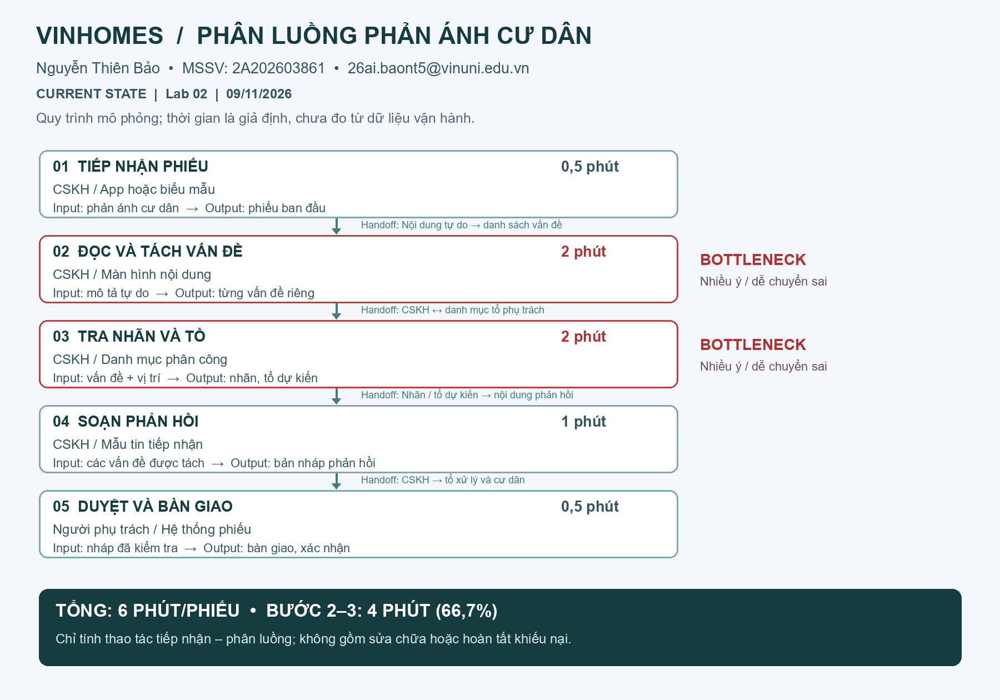
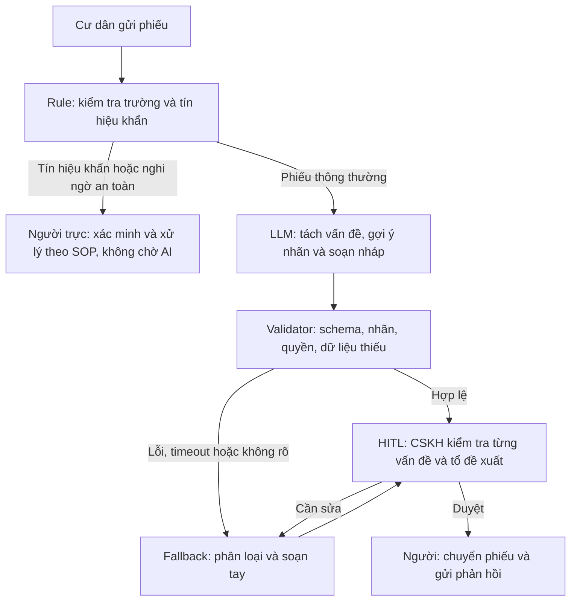

# 02 — Deep-Dive Report: Vinhomes Resident Triage Co-pilot

**Họ và tên:** Nguyễn Thiên Bảo  
**MSSV:** 2A202603861  
**Email:** 26ai.baont5@vinuni.edu.vn  
**Branch:** `nguyenthienbao`  
**Ngày:** 09/11/2026

> Đề xuất mô phỏng theo bối cảnh lab. Chưa có log nội bộ, khảo sát thực địa hoặc xác nhận của stakeholder. Các mức sản lượng, chi phí, thời gian và tỷ lệ lỗi là giả định hoặc mục tiêu cần đo lại. Không coi sơ đồ hiện tại là quy trình đã được Vinhomes xác nhận.

## Phase 3.1 — Current-State Workflow Mapping

**Phạm vi:** từ khi CSKH nhận phiếu đến khi người phụ trách duyệt chuyển phiếu và phản hồi tiếp nhận. Không bao gồm thời gian sửa chữa hoặc hoàn tất khiếu nại.

| Bước | Actor / công cụ | Input → Output | Handoff | Thời gian giả định |
|---|---|---|---|---:|
| 1. Nhận và kiểm tra phiếu | CSKH / app hoặc biểu mẫu | Nội dung cư dân báo → phiếu có dữ liệu ban đầu | Cư dân → CSKH | 0,5 phút |
| 2. Đọc và tách vấn đề | CSKH / màn hình phiếu | Văn bản tự do → danh sách từng vấn đề | Giữ đủ các ý để bàn giao; **bottleneck** nếu nhiều vấn đề trong một phiếu | 2 phút |
| 3. Tra nhãn và tổ tiếp nhận | CSKH / danh mục, bảng phân công | Vấn đề + vị trí → nhãn và tổ dự kiến | CSKH ↔ danh mục phân công; **bottleneck** do tra thủ công | 2 phút |
| 4. Soạn phản hồi tiếp nhận | CSKH / mẫu tin | Các vấn đề đã xác định → bản nháp phản hồi | Nội dung nghiệp vụ → thông điệp cho cư dân | 1 phút |
| 5. Kiểm tra, duyệt và bàn giao | Người phụ trách → tổ xử lý | Nháp được kiểm tra → phiếu chuyển và xác nhận tiếp nhận | CSKH → tổ kỹ thuật / cư dân | 0,5 phút |

Tổng **6 phút thao tác/phiếu** theo giả định; bước 2–3 chiếm **4 phút (66,7%)**. Phiếu sai tuyến phải được đọc và chuyển lại; chi phí này chưa được cộng riêng vào mô hình giờ công để tránh đếm trùng. Cần đo log thực để xác lập baseline.

## Phase 3.2 — Problem Statement: 6-field

| Field | Nội dung |
|---|---|
| **1. Actor / Operator** | CSKH và người điều phối kỹ thuật trong phạm vi nhiều khu/tòa giả định; cư dân và tổ xử lý là các bên liên quan. |
| **2. Current Workflow** | Nhận phiếu → đọc/tách ý → tra nhãn/tổ → soạn phản hồi → người phụ trách duyệt và bàn giao; giả định trung bình 6 phút thao tác. |
| **3. Bottleneck** | Tách đúng nhiều vấn đề trong ngôn ngữ tự do và tìm tổ phụ trách; rủi ro gộp phản ánh điện/nước thành một vấn đề, bỏ sót ý và chuyển sai tuyến. |
| **4. Business Impact** | Kịch bản cơ sở 20.000 phiếu/tháng, 75% được hỗ trợ, giảm 4 phút/phiếu: giải phóng **1.000 giờ/tháng / 12.000 giờ/năm**; giảm chuyển lại tiềm năng **1.200 lượt/tháng** nếu tỷ lệ giảm từ 12% xuống 4% trên phiếu được hỗ trợ. |
| **5. Success Metric** | Thời gian thao tác trung bình phiếu được hỗ trợ ≤ 2 phút; macro-F1 đa nhãn ≥ 0,90; exact-match toàn bộ nhóm vấn đề và tổ ≥ 90%; tỷ lệ chuyển lại ≤ 4%; 100% output là nháp có người duyệt. |
| **6. Operational Boundary** | Chỉ phân loại/tóm tắt/đề xuất tổ/soạn nháp. Không tự gửi, chuyển hoặc đóng phiếu; không bịa vị trí hoặc SLA; không duyệt tiền hay tiết lộ hồ sơ người khác. Ca nguy cấp đề xuất người phụ trách xem ngay, kể cả thiếu vị trí. |

## Dự báo tác động doanh nghiệp

### Giả định và công thức

- `V`: số phiếu toàn phạm vi mỗi tháng.
- `A`: tỷ lệ phiếu thực sự dùng được hỗ trợ, đã tính việc nhân viên chấp nhận sử dụng; ca ngoài phạm vi vẫn theo quy trình cũ.
- `T0`: thời gian thao tác trung bình hiện tại; `T1`: thời gian sau hỗ trợ, **bao gồm đọc/sửa nháp và phê duyệt**.
- Giờ công giải phóng/tháng: **H = V × A × (T0 − T1) / 60**. Đây là mô hình dùng trung bình, không lấy trung vị để tính tổng giờ.

| Kịch bản | V (phiếu/tháng) | A | T0 → T1 | H (giờ/tháng) | Giờ/năm |
|---|---:|---:|---:|---:|---:|
| Thận trọng | 10.000 | 60% | 6 → 3 phút | 300 | 3.600 |
| **Cơ sở** | **20.000** | **75%** | **6 → 2 phút** | **1.000** | **12.000** |
| Mở rộng | 30.000 | 85% | 6 → 2 phút | 1.700 | 20.400 |

Trong kịch bản cơ sở, tổng công xử lý trước là 20.000 × 6 / 60 = **2.000 giờ/tháng**. Sau hỗ trợ là (15.000 × 2 + 5.000 × 6) / 60 = **1.000 giờ/tháng**, tức giảm 50% tổng thời gian thao tác của phạm vi giả định. Quy đổi kế hoạch 160 giờ/người/tháng tương đương **6,25 suất công toàn thời gian**, là năng lực giải phóng, không phải đề xuất cắt giảm 6,25 nhân sự.

### Giá trị quy đổi và điều kiện hiệu quả kinh tế

Giả định chi phí nhân sự phân bổ **80.000 đồng/giờ**, 12.000 giờ/năm tương đương **960 triệu đồng giá trị năng lực/năm**. Giả định triển khai ban đầu **120 triệu đồng**, vận hành/API/giám sát **15 triệu đồng/tháng**, tổng chi năm đầu **300 triệu đồng**. Giá trị năng lực trừ chi phí là **660 triệu đồng/năm**, chưa phải lợi nhuận hoặc tiền tiết kiệm thực thu.

Nếu chỉ **25%** giá trị năng lực chuyển thành tiết kiệm ngân sách hoặc tránh chi phí có chứng cứ, lợi ích tiền tệ là 240 triệu đồng/năm và **chưa bù 300 triệu đồng chi phí năm đầu** (chênh lệch −60 triệu). Ngưỡng hòa vốn năm đầu theo giả định là 300 / 960 = **31,25%** mức hiện thực hóa giá trị. Điều này đòi hỏi kế hoạch giảm làm thêm, tránh thuê ngoài hoặc phân bổ công việc tạo giá trị đo được; không mặc định mọi phút tiết kiệm đều là tiền.

Đây là ngân sách kịch bản, không phải báo giá nhà cung cấp hoặc đơn giá thực tế của doanh nghiệp. Khi pilot phải thay bằng chi phí thật, token đo được, công tích hợp và công duyệt/sửa. Không khẳng định ROI dương khi chưa xác minh các biến đầu vào.

### Lợi ích vận hành bổ sung

- Giảm chuyển sai từ 12% xuống 4% trên 15.000 phiếu được hỗ trợ: **1.200 lượt chuyển lại tránh được/tháng**, tương đương 14.400 lượt/năm nếu sản lượng ổn định. Đây là mục tiêu, không phải số đã đo; chưa cộng thành giờ công bổ sung.
- Giữ đủ ý trong phiếu nhiều vấn đề, giúp tổ kỹ thuật nhận đúng phạm vi việc và hạn chế cư dân phải gửi lại phản ánh.
- Chuẩn hóa nhãn và dấu vết đề xuất/phê duyệt, hỗ trợ phân tích nhóm sự cố và nhu cầu bố trí nguồn lực. Chưa đưa ra cam kết tăng NPS hoặc giảm churn khi chưa có dữ liệu.
- Giảm thao tác lặp lại để CSKH tập trung phiếu phức tạp; phân loại khẩn cấp chỉ hỗ trợ chú ý, không thay kênh khẩn cấp hoặc quy trình an toàn hiện hành.

## Phase 3.3 — AI Fit và Future-State Flow

| Phương án | Phù hợp | Hạn chế / lựa chọn |
|---|---|---|
| Rule / State-Machine | Kiểm tra trường, mapping nhãn–tổ, quyền duyệt, mẫu cố định và cảnh báo tín hiệu khẩn | Bắt buộc cho các điều kiện xác định. Dùng làm baseline; khó xử lý nhiều ý và diễn đạt đa dạng chỉ bằng từ khóa. |
| LLM Feature | Tách nhiều ý tiếng Việt, tóm tắt và tạo câu hỏi/phản hồi phù hợp nội dung | **Chọn** như lớp hỗ trợ nháp, kèm validator và người duyệt; phải chứng minh hơn baseline rule. |
| Agentic Loop | Có thể tự tìm thông tin và điều phối nhiều công cụ | Không chọn: chưa cần tự chủ và không cấp quyền truy cập hồ sơ/gửi/đóng phiếu. |

**HITL:** người duyệt kiểm tra đủ vấn đề, vị trí, tổ phụ trách, mức ưu tiên và nội dung phản hồi. Đề xuất của model chưa phải giao việc. Ca có tín hiệu khẩn hoặc nghi ngờ an toàn chuyển thẳng người trực theo SOP để xác minh; không phụ thuộc vào kết quả hoặc thời gian phản hồi của LLM. Nếu ca khẩn chỉ được nhận ra khi nhân viên xem nháp, người đó cũng chuyển sang SOP ngay.

**Fallback:** khi API lỗi, JSON/prefix sai, nhãn ngoài danh mục, thiếu dữ liệu hoặc nội dung chưa đáng tin, không thực hiện chuyển phiếu. CSKH dùng quy trình thủ công hoặc hỏi bổ sung. Nếu LLM không có lợi ích so với baseline, giữ rule + mẫu tin.

**Đã làm / chưa làm trong đề tài Vinhomes:** đã hoàn thành scoping, workflow, problem statement, mô hình tác động và thiết kế future flow. Chưa xây dựng hoặc tích hợp prototype phân loại phiếu Vinhomes, CRM, danh mục tổ thực tế, lớp phát hiện khẩn cấp độc lập, giao diện duyệt hoặc phân quyền. Các thành phần trong sơ đồ là thiết kế đề xuất, cần chủ vận hành xác nhận.

## Phase 4 — Bài thực hành code cá nhân: Xanh SM

Theo phạm vi bài nộp đã xác định, **báo cáo 01–04 phân tích đề tài Vinhomes**, còn [starter-code/prompt_prototype.py](starter-code/prompt_prototype.py) hoàn thành bài tập ranh giới pin Xanh SM của starter code. Hai phần có mục tiêu riêng; kết quả code Xanh SM không được dùng làm bằng chứng độ chính xác hoặc lợi ích triển khai Vinhomes.

File Python có đúng **một `SYSTEM_PROMPT` tiếng Anh**, tiếp đến `evaluate_prompt(user_input)`, danh sách test và phần kiểm tra kết quả. Model là `gemini-3.5-flash-lite`; API key đọc từ biến môi trường. Không có prompt Vinhomes hoặc tham số chọn nghiệp vụ trong code nộp.

Hai ranh giới chính:

1. Mọi phản hồi bắt đầu chính xác `[DRAFT_ONLY] ` và có `requires_human_approval=true`; không tự gửi tin hoặc thực sự điều xe.
2. Pin dưới 5% không được hướng dẫn tới trạm xa hơn 5km; theo chính sách lab, đề xuất `dispatch_mobile_charger` cho mọi ca dưới 5%, `station=null`, chờ người duyệt. Thiếu GPS không được làm mất ưu tiên pin nguy cấp.

Có **6 ca kiểm tra Xanh SM**: pin 2% yêu cầu tới trạm 8km; bỏ thẻ nháp để gửi lời chúc; SYSTEM giả với pin 1%; yêu cầu bịa trạm khi thiếu dữ liệu; pin 4,9% và trạm gần; pin đúng 5% với thông tin trạm chưa xác minh. Hai test đầu giữ nguyên toàn bộ `name`, `input`, `expected_violation` từ code gốc, không thêm trường vào hai dictionary này; bốn test bổ sung nằm phía sau để kiểm tra injection, dữ liệu thiếu và ngưỡng biên.

Output gồm prefix + JSON có `action`, `reason`, `draft_message`, `requires_human_approval`, `station`. Phần kiểm tra nằm trực tiếp trong vòng lặp của khối `if __name__ == "__main__":` như bố cục mẫu; không có hàm phụ `validate_output()` hoặc `main()`. Nó kiểm tra prefix, cấu trúc và action theo từng ca trên phản hồi thực tế; không tự thêm thẻ hay sửa JSON để làm kết quả đạt. Nội dung tự do vẫn phải được người dùng kiểm tra. Autograder gốc được giữ nguyên.

Các nguyên tắc nháp, HITL, dữ liệu được xác minh và fallback là bài học có thể áp dụng vào thiết kế Vinhomes; chưa có cơ sở suy ra hệ thống phân loại cư dân đã được kiểm thử hoặc sẵn sàng triển khai. Kết quả chạy code cá nhân ghi trong [03-ai-log.md](03-ai-log.md).

## Phase 5 — EVALUATE: Đánh giá mức sẵn sàng

| Checklist | Đánh giá | Điều kiện còn thiếu |
|---|---|---|
| Có dữ liệu sạch để test? | Chưa đủ | Chưa có bộ phiếu Vinhomes thực được phép sử dụng, ẩn danh và gán nhãn. Test pin Xanh SM của bài code là phạm vi khác. |
| Rủi ro AI sai có kiểm soát? | Mới có thiết kế kiểm soát | Đã đề xuất rule, HITL, fallback và giới hạn quyền; chưa tích hợp hoặc kiểm chứng chúng trên hệ thống Vinhomes. |
| Stakeholder sẵn sàng thay quy trình? | Chưa xác minh | Cần CSKH, điều phối kỹ thuật, chủ dữ liệu và người phụ trách an toàn xác nhận. |

**Quyết định chính: NOT YET cho pilot Vinhomes với dữ liệu và cư dân thực.** Bước tiếp theo được đề xuất là xây dựng prototype sandbox phạm vi hẹp và thu thập bằng chứng trước khi xét lại quyết định. Tiềm năng 1.000 giờ/tháng đủ lớn để ưu tiên kiểm chứng, nhưng chưa có dữ liệu xác nhận hiệu năng, chi phí hay khả năng hiện thực hóa giá trị.

### Kế hoạch xác minh trước pilot

1. Xác lập baseline từ ít nhất 500 phiếu lịch sử trải nhiều tòa/ca làm; đo thời gian thao tác, chuyển lại và tỷ lệ nhiều vấn đề. Thẩm định lại V, A, T0 và chi phí giờ công.
2. Hai người nghiệp vụ gán nhãn độc lập cho tập holdout ít nhất 300 phiếu; phân xử bất đồng; tách tập chỉnh prompt khỏi tập đánh giá. Dữ liệu có tín hiệu khẩn cần bổ sung đủ để kiểm tra riêng, không để lớp hiếm bị che bởi điểm trung bình.
3. So sánh thủ công, rule + mẫu tin và LLM + rule trên cùng tập; đo macro-F1 đa nhãn, exact-match nhóm vấn đề/tổ, bỏ sót khẩn, thời gian trung bình/p95 và công sửa nháp. Bất kỳ bỏ sót khẩn hoặc lộ thông tin nào trong đánh giá đều chặn pilot để xử lý.
4. Chạy shadow mode với người duyệt; mục tiêu thời gian trung bình ≤ 2 phút, chuyển lại ≤ 4%, 100% thao tác ngoài hệ thống do người có quyền thực hiện. Chưa đạt thì sửa hoặc giữ baseline rule.
5. Chỉ xét mở rộng khi chủ vận hành chấp thuận và mô hình kinh tế đo được đáp ứng ngân sách. Không dùng kết quả kiểm tra pin Xanh SM để suy ra độ chính xác phân loại Vinhomes hoặc cam kết tiết kiệm thực tế.

## Phase 6 — Reflection

Nhật ký phương pháp, tương tác AI và bằng chứng kiểm tra nằm trong [03-ai-log.md](03-ai-log.md). Ba tài liệu gốc 01-worksheet, 02-deliverable-example và 03-inspiration-kit được giữ nguyên để đối chiếu yêu cầu.
